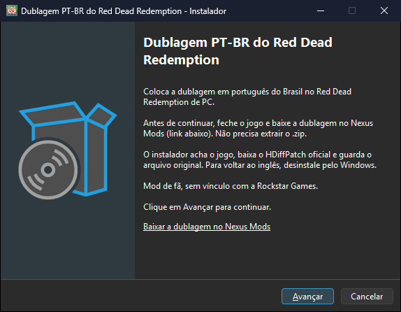
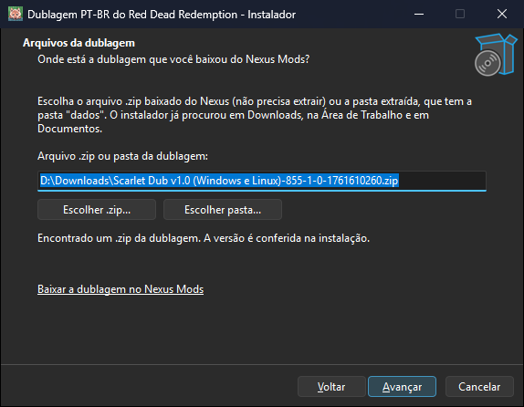
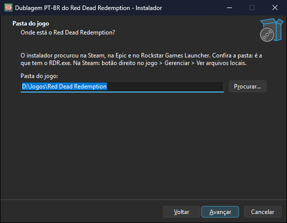
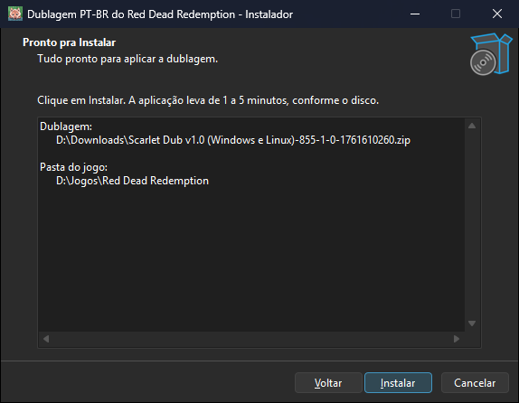
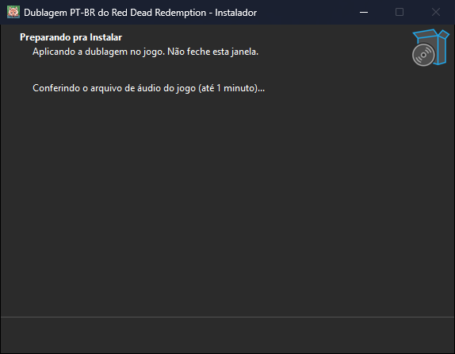
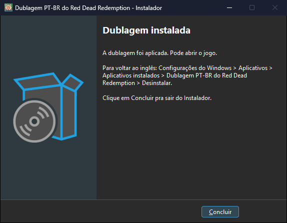
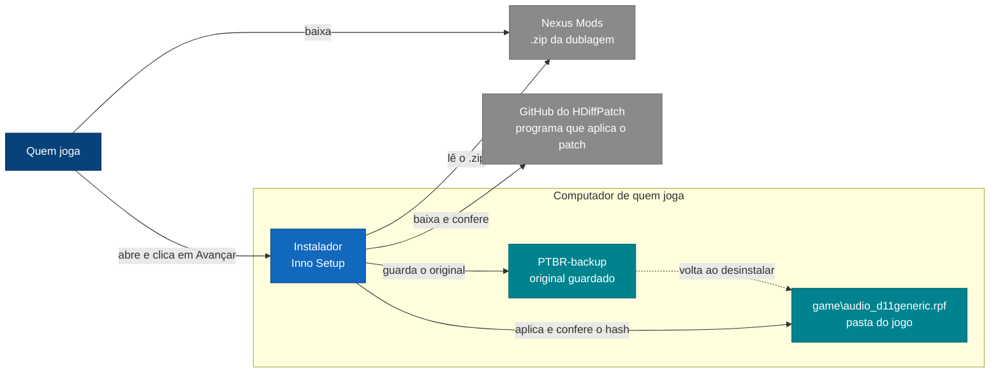
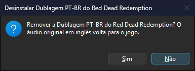
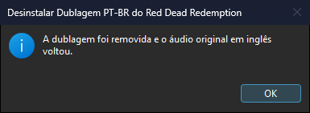

# 🎮 Instalador da dublagem PT-BR do Red Dead Redemption

**O Red Dead Redemption de PC dublado em português do Brasil, aplicado por um instalador com telas: você abre, clica em Avançar e a dublagem entra no jogo. Para voltar ao inglês, é só desinstalar pelo Windows.**

[Como instalar](#-como-instalar) · [Guia completo](docs/installation.md) · [Baixar o instalador](https://github.com/scarletmodder/rdr1-ptbr-instalador/releases/latest) · [Baixar a dublagem no Nexus](https://www.nexusmods.com/reddeadredemption/mods/855?tab=files) · [Changelog](CHANGELOG.md)

**Neste documento:** [Como instalar](#-como-instalar) · [Requisitos](#-requisitos) · [Por que existe](#-por-que-existe) · [O que o instalador faz](#%EF%B8%8F-o-que-o-instalador-faz) · [Remover](#%EF%B8%8F-remover-a-dublagem) · [Segurança](#-segurança-e-privacidade) · [Linux, Steam Deck e outras formas](#-linux-steam-deck-e-outras-formas-de-instalar) · [Estado](#%EF%B8%8F-estado-atual) · [Para quem contribui](#-para-quem-contribui)

## 🚀 Como instalar

1. **Baixe a dublagem** na [página do mod no Nexus Mods](https://www.nexusmods.com/reddeadredemption/mods/855?tab=files) e deixe o .zip na pasta Downloads, sem extrair.
2. **Baixe o instalador** `Instalador-Dublagem-PTBR-RDR1-v<versão>.exe` na [página de downloads](https://github.com/scarletmodder/rdr1-ptbr-instalador/releases/latest).
3. **Feche o jogo** e abra o instalador com dois cliques.
4. **Clique em Avançar** em cada tela: o instalador acha a dublagem e o jogo sozinho. Confira e clique em **Instalar**. Na última tela, a mensagem é "A dublagem foi aplicada. Pode abrir o jogo."

| 1. Boas-vindas | 2. Arquivos da dublagem |
|---|---|
|  |  |
| **3. Pasta do jogo** | **4. Pronto para instalar** |
|  |  |
| **5. Aplicando** | **6. Concluído** |
|  |  |

Os caminhos que aparecem nas capturas são exemplos. Na sua máquina, o instalador procura a dublagem e o jogo sozinho, e você pode trocar os dois.

> [!TIP]
> O passo a passo com os avisos do Windows, a remoção e a lista de problemas está no [guia de instalação](docs/installation.md).

## 📋 Requisitos

- **Windows 10 ou 11, de 64 bits.** Não precisa instalar nada antes: nem .NET, nem Visual C++, nem outro programa. O instalador é autônomo, e o HDiffPatch que ele baixa só usa bibliotecas do próprio Windows ([detalhes](docs/installation.md#precisa-instalar-alguma-coisa-antes)).
- **Red Dead Redemption de PC** na Steam, na Epic ou no Rockstar Games Launcher, atualizado e sem outro mod de áudio. A versão do Xbox (Microsoft Store) não funciona.
- **Cerca de 4 GB livres** no disco do jogo e **internet** durante a instalação, para baixar o HDiffPatch.

Linux e Steam Deck usam o [zip de scripts](#-linux-steam-deck-e-outras-formas-de-instalar).

## 🎯 Por que existe

A dublagem é um patch sobre o arquivo de áudio do seu próprio jogo, distribuído no [Nexus Mods](https://www.nexusmods.com/reddeadredemption/mods/855). O Nexus não aceita programas dentro do pacote do mod, e aplicar um patch à mão exige baixar outro programa e digitar comandos. Este instalador faz isso por você, com telas, sem terminal, e com o código aberto para quem quiser conferir.

É um projeto de fã, sem vínculo com a Rockstar Games, a Take-Two ou a Double Eleven. O que está dublado em cada versão está descrito na página do mod.

## ⚙️ O que o instalador faz

- **Acha a dublagem** em Downloads, na Área de Trabalho, em Documentos e na pasta do próprio instalador. Aceita o .zip baixado do Nexus, sem extrair, ou a pasta já extraída.
- **Acha o jogo** na Steam, na Epic, no Rockstar Games Launcher e nas pastas de jogos mais comuns.
- **Confere antes de mexer:** só aplica se o arquivo de áudio do jogo for idêntico ao original esperado, pela impressão digital SHA-256.
- **Baixa o HDiffPatch** do [repositório oficial do autor](https://github.com/sisong/HDiffPatch) (código aberto, licença MIT). A versão testada tem o hash conferido; se houver uma mais nova, ele baixa a mais nova.
- **Guarda o original** na pasta `PTBR-backup`, dentro da pasta do jogo, aplica o patch num arquivo novo e só troca depois de conferir o resultado. Se algo falhar, o original volta.
- **Aparece na lista de aplicativos do Windows**, de onde a dublagem é removida.

## 🗑️ Remover a dublagem

Feche o jogo e abra **Configurações**, **Aplicativos**, **Aplicativos instalados**. Procure **"Dublagem PT-BR do Red Dead Redemption"** e escolha **Desinstalar**. O atalho **Remover a dublagem (voltar ao inglês)**, no menu Iniciar, faz o mesmo.

| Confirmação | Pronto |
|---|---|
|  |  |

O original guardado volta para o lugar, depois de conferido pelo hash, e a pasta `PTBR-backup` é apagada.

## 🔒 Segurança e privacidade

- **Nenhum arquivo do jogo** neste repositório nem no instalador. A dublagem vem do Nexus e o patch é aplicado sobre o seu jogo.
- **Internet só para o HDiffPatch**, baixado do repositório oficial do autor. Sem internet, o instalador usa o .zip oficial do HDiffPatch que estiver na pasta Downloads, depois de conferir o hash.
- **Nunca troca o arquivo sem conferir:** o resultado só entra no jogo se o hash bater com o da dublagem. Não mexe em saves.
- **Pede administrador** porque altera um arquivo dentro da pasta do jogo, que costuma ser protegida.
- **Sem assinatura digital.** O Windows pode avisar que o arquivo é desconhecido. Você pode conferir o hash do instalador com o `SHA256SUMS.txt` da release ou compilar pelo código. Veja [como conferir](docs/installation.md#2-conferir-o-arquivo-opcional).

## 🐧 Linux, Steam Deck e outras formas de instalar

O instalador .exe é só para Windows. Cada release traz também o `Instalador-Dublagem-PTBR-RDR1-Scripts-v<versão>.zip`, com os scripts de instalação para os outros casos. Extraia esse zip dentro da pasta do mod, ao lado do `LEIA-ME.txt` e da pasta `dados`, como o LEIA-ME do pacote do Nexus explica:

| Sistema | Como instalar | Como remover |
|---|---|---|
| Linux e Steam Deck (Modo Desktop) | Num terminal aberto na pasta do mod: `bash instalar-linux.sh` | `bash instalar-linux.sh remover` |
| Windows, sem o .exe | Dois cliques em `Instalar dublagem.cmd` | Dois cliques em `Remover dublagem.cmd` |

- No Linux e no Steam Deck, o script acha o jogo na Steam nativa, no Flatpak, no cartão SD do Deck e no Heroic, e não precisa de `sudo`. Ele usa o [HDiffPatch para Linux](https://github.com/sisong/HDiffPatch/releases/download/v5.1.3/hdiffpatch_v5.1.3_bin_linux64.zip), que você deixa na pasta Downloads, sem extrair.
- No Windows, os lançadores `.cmd` rodam os scripts `.ps1` liberando scripts só naquela execução. Não use "Executar com o PowerShell" do menu: no Windows 11, com scripts bloqueados (o padrão), a janela abre e fecha sem fazer nada. Esses scripts usam o [HDiffPatch para Windows](https://github.com/sisong/HDiffPatch/releases/download/v5.1.3/hdiffpatch_v5.1.3_bin_windows64.zip), também deixado em Downloads.

A instalação manual, sem nenhum script, está descrita no `LEIA-ME.txt` do mod e na página do Nexus.

## 🗺️ Estado atual

| Área | Estado | Como foi conferido |
|---|---|---|
| Instalar pelo .zip do Nexus | ✅ pronto | Testes automáticos com jogo sintético, e uma instalação pelas telas com o pacote real da dublagem v1.0 sobre o arquivo de áudio original: hash do resultado igual ao da dublagem |
| Pasta extraída e versão nova | ✅ pronto | Testes automáticos: aplica a partir da pasta extraída e de uma versão nova sobre o original guardado |
| Recusar o que não confere | ✅ pronto | Testes automáticos: arquivo do jogo de outra origem, resultado que não bate e pasta que não é do jogo deixam o jogo como estava |
| Baixar o HDiffPatch | ✅ pronto | Testado baixando do GitHub (fora do CI) e, sem internet, com o .zip oficial na pasta Downloads (no CI) |
| Interrupção no meio | ✅ pronto | Teste automático: com o arquivo de áudio sumido e o original em `PTBR-backup`, o instalador reconhece a pasta e termina |
| Remover pela lista do Windows | ✅ pronto | Testes automáticos, inclusive depois de a loja devolver o original ou atualizar o arquivo, e uma remoção real, abrindo o desinstalador como o Windows abre: o original voltou com o hash conferido. O clique pela página de Configurações em si não foi gravado |
| Scripts de Windows (`.cmd`) | ✅ pronto | Teste automático pelos lançadores, com scripts bloqueados na sessão: instala e remove |
| Script de Linux e Steam Deck | ⚠️ só em pastas simuladas | Conferido na versão 0.7.1 em pastas que imitam a Steam, o Flatpak, o cartão SD e o Heroic; não testado com o jogo rodando no Linux |
| Aviso de administrador e SmartScreen | ⚠️ não capturado | As capturas foram feitas no modo por usuário, sem o aviso de administrador |
| Antivírus | ⚠️ não medido | Ainda sem medida com o instalador publicado |
| Epic e Rockstar Games Launcher | ⚠️ só pela busca | A detecção segue os manifestos dessas lojas, mas não foi conferida com o jogo instalado por elas |

## 🧑‍💻 Para quem contribui

| Comando | O que faz |
|---|---|
| `scripts\build.ps1` | Compila o instalador com o Inno Setup 6.7, monta o zip de scripts e grava `dist\SHA256SUMS.txt` |
| `tests\test-installer.ps1` | Instala, atualiza, interrompe e remove num jogo sintético, em 13 cenários, sem tocar no jogo real. `-Online` deixa o instalador baixar o HDiffPatch do GitHub |
| `tests\test-scripts.ps1` | Instala e remove pelos lançadores `.cmd`, com scripts bloqueados na sessão |
| `scripts\capture-screenshots.ps1` | Refaz as capturas do guia. Recusa caminhos que mostrem o nome de usuário |
| `python scripts/guard.py --root .` | Barra dado pessoal, segredo e travessão antes de qualquer commit |

O código do instalador está em [installer/rdr1-ptbr.iss](installer/rdr1-ptbr.iss).

## 📄 Licença

Instalador e scripts por Scarlet Modder, sob a licença [MIT](LICENSE), que cobre só o código e o texto deste repositório. Red Dead Redemption é marca da Rockstar Games e da Take-Two Interactive. O HDiffPatch é de sisong, sob a licença MIT, e não é redistribuído aqui: o instalador baixa do repositório do autor.
