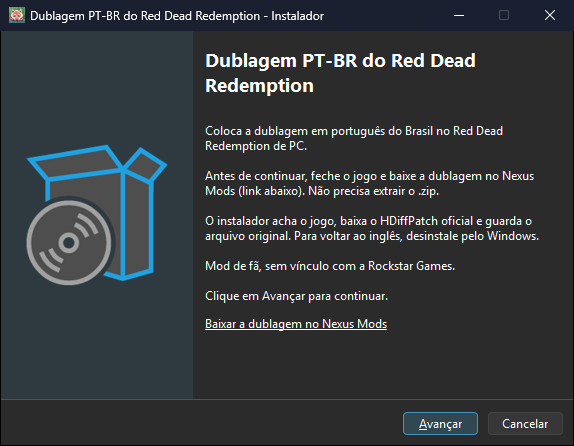
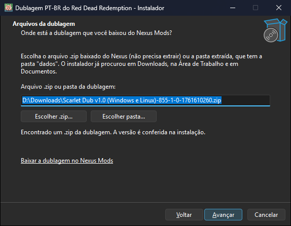
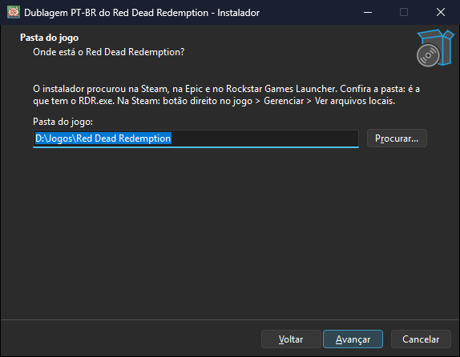
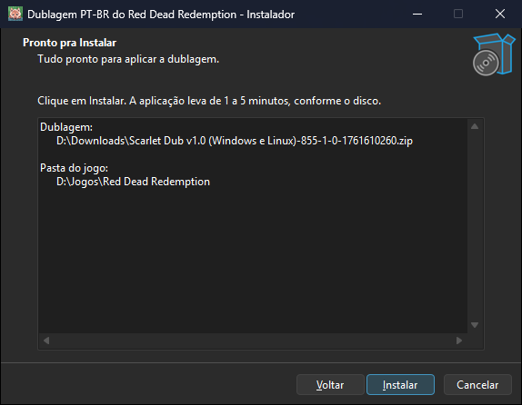
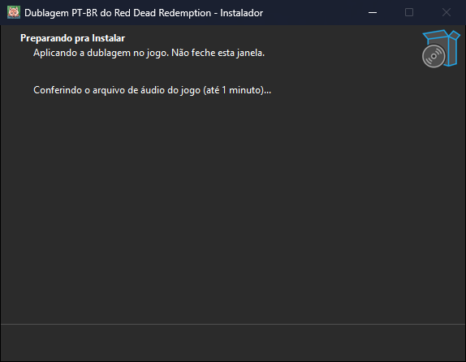
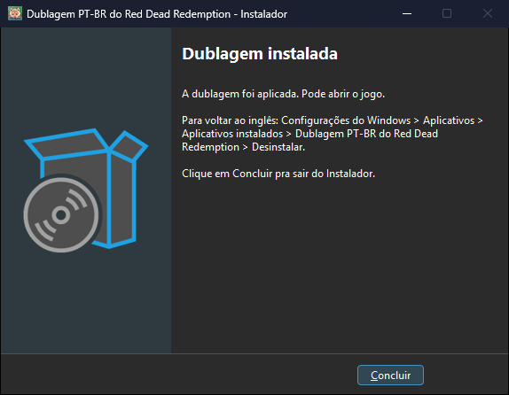
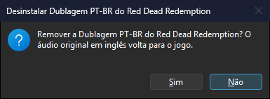
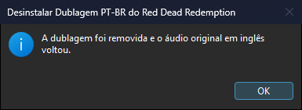

<div align="center">

# 🚀 Guia de instalação

**Da página do mod no Nexus até o jogo dublado, com as telas do instalador e a remoção no final.**

[Voltar ao README](../README.md) · [Instalar](#-instalar) · [Atualizar](#-atualizar-para-uma-versão-nova-da-dublagem) · [Remover](#%EF%B8%8F-remover-a-dublagem) · [Avisos do Windows](#%EF%B8%8F-avisos-do-windows-e-do-antivírus) · [Problemas](#-problemas-comuns) · [Linux e Steam Deck](#-linux-e-steam-deck)

</div>

## 🎯 Antes de começar

Você vai precisar de:

- **Windows 10 ou 11.** O instalador foi conferido no Windows 11.
- **Red Dead Redemption de PC**, versão Steam, Epic ou Rockstar Games Launcher, atualizado e sem outro mod que troque o áudio do jogo. A versão do Xbox (Microsoft Store) não funciona: o Windows protege os arquivos dela.
- **A dublagem baixada do [Nexus Mods](https://www.nexusmods.com/reddeadredemption/mods/855?tab=files).** É um .zip de cerca de 400 MB. Não precisa extrair.
- **Internet durante a instalação**, para o instalador baixar o HDiffPatch, o programa de código aberto que aplica o patch. Sem internet, veja [este caso](#-problemas-comuns).
- **Cerca de 4 GB livres** no disco do jogo.

O instalador não traz nenhum arquivo do jogo nem a dublagem: ele aplica sobre o seu jogo o patch que você baixou do Nexus.

## 🚀 Instalar

**Neste passo a passo:** [1. Baixar](#1-baixar) · [2. Conferir](#2-conferir-o-arquivo-opcional) · [3. Abrir](#3-abrir-o-instalador) · [4. Instalar](#4-instalar-pelas-telas) · [5. Jogar](#5-jogar)

### 1. Baixar

1. Na [página do mod no Nexus Mods](https://www.nexusmods.com/reddeadredemption/mods/855?tab=files), baixe o arquivo principal da dublagem. Deixe o .zip na pasta Downloads, sem extrair.
2. Na [página de downloads deste repositório](https://github.com/scarletmodder/rdr1-ptbr-instalador/releases/latest), baixe:

| Arquivo | O que é |
|---|---|
| `Instalador-Dublagem-PTBR-RDR1-v<versão>.exe` | O instalador. É tudo de que você precisa |
| `SHA256SUMS.txt` | O hash do instalador, para conferir o download |

### 2. Conferir o arquivo (opcional)

O instalador não tem assinatura digital, que é paga. Para ter certeza de que o arquivo é o publicado, compare o hash dele (a impressão digital do arquivo) com o do `SHA256SUMS.txt`. No PowerShell, na pasta do download:

```powershell
Get-FileHash .\Instalador-Dublagem-PTBR-RDR1-v*.exe -Algorithm SHA256
```

O resultado tem de ser igual à linha do instalador no `SHA256SUMS.txt` **da mesma release**. Se preferir não confiar em arquivo pronto, compile pelo código com `scripts\build.ps1`.

### 3. Abrir o instalador

Feche o jogo. Depois abra o arquivo baixado com dois cliques.

- O Windows pode mostrar "O Windows protegeu o computador", porque o arquivo não tem assinatura digital. Clique em **Mais informações** e em **Executar assim mesmo**.
- Em seguida o Windows pede permissão de administrador, porque a dublagem altera um arquivo dentro da pasta do jogo. Clique em **Sim**.

O texto exato desses avisos é do Windows e pode variar entre versões.

### 4. Instalar pelas telas

**Boas-vindas.** Se você ainda não baixou a dublagem, o link **Baixar a dublagem no Nexus Mods** abre a página do mod. Clique em **Avançar**.



**Arquivos da dublagem.** O instalador procura o .zip da dublagem em Downloads, na Área de Trabalho, em Documentos e na pasta onde o próprio instalador está, e preenche o campo com o mais recente. Confira, ou use **Escolher .zip...** (o arquivo baixado do Nexus) ou **Escolher pasta...** (se você já tinha extraído; é a pasta que tem a pasta `dados`). Clique em **Avançar**.



*Os caminhos das capturas são exemplos.*

**Pasta do jogo.** O instalador procura o jogo na Steam, na Epic, no Rockstar Games Launcher e nas pastas de jogos mais comuns. Confira a pasta: é a que tem o `RDR.exe`. Na Steam, a pasta abre pelo botão direito no jogo, **Gerenciar**, **Ver arquivos locais**. Clique em **Avançar**.



Se a pasta não for a do jogo, o instalador avisa antes de continuar: "Não encontrei o arquivo de áudio do jogo (game\audio_d11generic.rpf) nesta pasta".

**Pronto para instalar.** Confira o resumo e clique em **Instalar**.



**Aplicando.** O instalador mostra cada etapa: confere se o jogo está fechado, abre o .zip, confere o arquivo de áudio do seu jogo, baixa o HDiffPatch oficial, guarda o original e aplica a dublagem. Leva de 1 a 5 minutos, conforme o disco. Não feche a janela.



**Concluído.** A mensagem é "A dublagem foi aplicada. Pode abrir o jogo." Clique em **Concluir**.



### 5. Jogar

Abra o jogo como sempre. A dublagem toca com o jogo em qualquer idioma; para as legendas em português, escolha Português no menu do jogo.

## 🔍 O que o instalador faz no seu computador

1. Confere se o jogo está fechado e se a pasta escolhida é do jogo.
2. Abre o .zip da dublagem numa pasta temporária e lê o `dados\versao.json`, que diz o tamanho e o hash do arquivo original e do dublado.
3. Confere o `game\audio_d11generic.rpf` do seu jogo. Só continua se ele for idêntico ao original esperado, ou se o original já estiver guardado de uma instalação anterior.
4. Baixa o HDiffPatch do [repositório oficial do autor](https://github.com/sisong/HDiffPatch/releases). A versão 5.1.3, testada com a dublagem, tem o hash conferido no download. Se houver uma versão mais nova, o instalador baixa a mais nova, sempre do repositório do autor.
5. Move o arquivo original para a pasta `PTBR-backup`, dentro da pasta do jogo.
6. Aplica o patch num arquivo novo, confere tamanho e hash do resultado e só então coloca o arquivo no lugar. Se qualquer passo falhar, o original volta e nada fica pela metade.
7. Cria a entrada "Dublagem PT-BR do Red Dead Redemption" na lista de aplicativos do Windows e, no menu Iniciar, os atalhos **Remover a dublagem (voltar ao inglês)** e **Guia de instalação**.

O instalador não mexe em saves e só acessa a internet para consultar e baixar o HDiffPatch no GitHub. Os arquivos temporários (o .zip aberto e o HDiffPatch) são apagados ao final.

## 🔄 Atualizar para uma versão nova da dublagem

Baixe o .zip da versão nova no Nexus e rode o instalador de novo. Não precisa remover a versão antiga: o instalador parte do original guardado em `PTBR-backup` e aplica a versão nova sobre ele.

Se a mesma versão já estiver instalada, o instalador termina sem alterar nada.

## 🗑️ Remover a dublagem

A remoção é feita pela lista de aplicativos do Windows e devolve o áudio original em inglês.

1. Feche o jogo.
2. Abra **Configurações**, **Aplicativos**, **Aplicativos instalados**.
3. Procure **"Dublagem PT-BR do Red Dead Redemption"** (editora "Scarlet Modder") e escolha **Desinstalar**. O atalho **Remover a dublagem (voltar ao inglês)**, no menu Iniciar, faz o mesmo.
4. Confirme com **Sim**.

   

5. Quando terminar, aparece esta caixa. Clique em **OK**.

   

O desinstalador confere o hash do original guardado antes de usá-lo, coloca-o de volta no lugar e apaga a pasta `PTBR-backup`. O .zip da dublagem e o instalador que você baixou não são apagados.

<details>
<summary>Casos especiais da remoção</summary>

| Situação | O que acontece |
|---|---|
| O jogo está aberto | Aparece "O jogo está aberto. Feche o Red Dead Redemption e desinstale de novo." Nada é removido |
| A pasta `PTBR-backup` foi apagada | O desinstalador avisa e sai da lista sem mexer no jogo. Para voltar ao inglês, use a verificação de arquivos da loja (Steam: Propriedades, Arquivos instalados, Verificar integridade) |
| O arquivo em `PTBR-backup` não é o original | O desinstalador não usa esse arquivo e indica a verificação de arquivos da loja |
| O Windows não deixou devolver o original | Aparece "Não consegui devolver o original" e nada é removido. Feche o jogo e o launcher e desinstale de novo |

</details>

> [!WARNING]
> Não apague a pasta `PTBR-backup` enquanto usar a dublagem: é dela que a remoção e as próximas versões partem. Sem ela, só a verificação de arquivos da loja devolve o inglês.

## 🛡️ Avisos do Windows e do antivírus

O instalador é um executável sem assinatura digital, de projeto aberto. Por isso o Windows mostra o aviso "O Windows protegeu o computador" na primeira vez, e alguns antivírus podem desconfiar dele. É um falso positivo: o instalador faz só o que está no código aberto deste repositório ([installer/rdr1-ptbr.iss](../installer/rdr1-ptbr.iss)).

O comportamento do antivírus ainda não foi medido com o instalador publicado. Para ter certeza de que o arquivo é o publicado, [confira o hash ou compile pelo código](#2-conferir-o-arquivo-opcional).

## 🩺 Problemas comuns

| Sintoma na tela | Causa provável | O que fazer |
|---|---|---|
| `Não achei a dublagem sozinho.` | O .zip não está em Downloads, na Área de Trabalho nem em Documentos | Use **Escolher .zip...** e aponte o arquivo baixado do Nexus |
| `Não reconheci a dublagem em: ...` | O arquivo escolhido não é a dublagem, ou a pasta não tem a pasta `dados` | Escolha o .zip baixado do Nexus ou a pasta extraída que tem `dados` |
| `Não encontrei o arquivo de áudio do jogo ... nesta pasta` | A pasta escolhida não é a do jogo | Escolha a pasta que tem o `RDR.exe` |
| `O jogo está aberto.` | O jogo está rodando | Feche o jogo e clique em **Instalar** de novo |
| `O Windows não deixa alterar os arquivos da versão do Xbox` | Jogo da Microsoft Store ou do Xbox app | A dublagem funciona só nas versões Steam, Epic e Rockstar |
| `O arquivo de áudio do seu jogo é diferente do esperado` | Outra versão do jogo ou outro mod de áudio | Verifique os arquivos do jogo pela loja e rode de novo. Se o jogo atualizou, aguarde uma versão nova da dublagem |
| `Já existe uma pasta PTBR-backup no jogo com um arquivo que não é o original.` | Sobrou uma pasta de outra tentativa ou de outro mod | Apague essa pasta só se tiver certeza e rode de novo |
| `Falta espaço no disco do jogo` | Menos de cerca de 4 GB livres | Libere espaço no disco do jogo |
| `Não consegui baixar o HDiffPatch do GitHub` | Sem internet, ou o GitHub não respondeu | Confira a internet. Sem internet, baixe em outro aparelho o [hdiffpatch_v5.1.3_bin_windows64.zip](https://github.com/sisong/HDiffPatch/releases/download/v5.1.3/hdiffpatch_v5.1.3_bin_windows64.zip) e deixe na pasta Downloads: o instalador usa esse arquivo depois de conferir o hash |
| `Não consegui mexer no arquivo de áudio do jogo` | O jogo, o launcher ou o antivírus estão usando o arquivo | Feche o jogo e o launcher e tente de novo |
| `O arquivo gerado não confere com a dublagem.` | O .zip baixado veio corrompido, ou o disco falhou | O jogo fica com o áudio original. Baixe o .zip de novo e rode outra vez |

Em todos esses casos o jogo fica como estava: o instalador só troca o arquivo depois de conferir o resultado.

## 🐧 Linux e Steam Deck

O instalador .exe é só para Windows. No Linux e no Steam Deck (Modo Desktop), use o script `instalar-linux.sh`, que está na [página de downloads](https://github.com/scarletmodder/rdr1-ptbr-instalador/releases), e siga as instruções do LEIA-ME.txt do mod.

## 📚 Documentação

| Documento | O que tem |
|---|---|
| [README](../README.md) | Visão geral, telas do instalador e como ele funciona |
| [Página do mod no Nexus Mods](https://www.nexusmods.com/reddeadredemption/mods/855) | O download da dublagem, o que está dublado e o histórico de versões |
